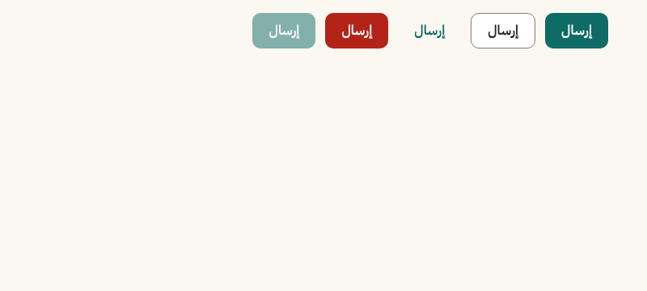
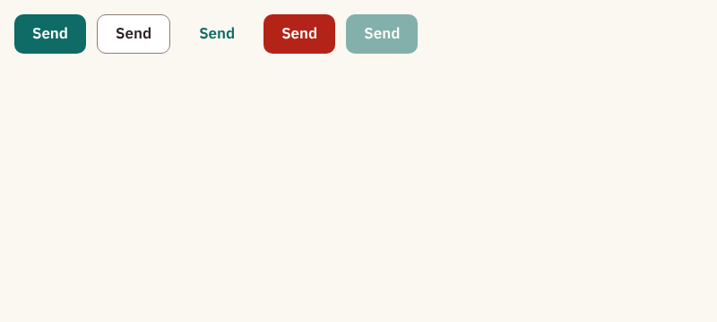
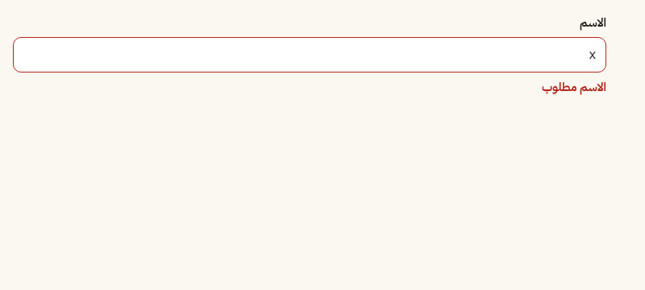
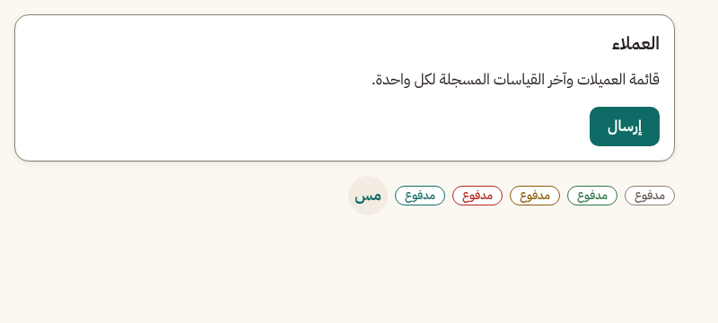
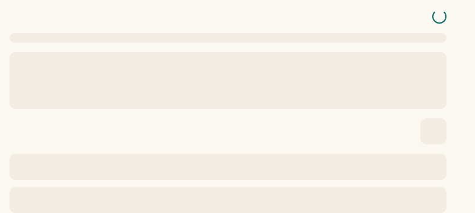
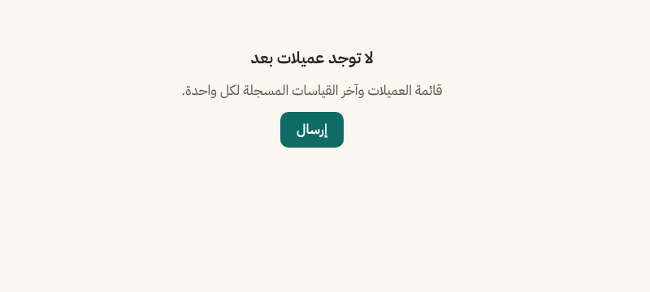
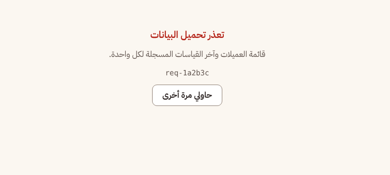
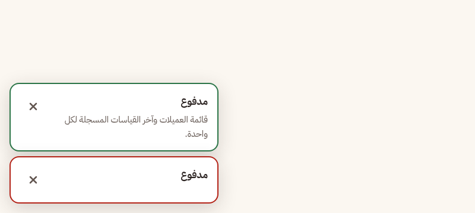

# Using the design system

How to build a screen from `packages/ui` so every page looks and behaves the same. This is the **how-to**; the brand itself (palette, type, voice, principles) is in [the design system](../design-system/README.md), its values in [`tokens.json`](../design-system/tokens.json), and the generated Tailwind theme in [`packages/ui/src/tokens.css`](../../packages/ui/src/tokens.css) (ADR-80: change the brand in `tokens.json`, run `pnpm tokens`, never edit the generated block). Component decisions: ADR-031 and ADR-033; error placement: ADR-030 and ADR-72 (see [the list](README.md#decisions)).

Screenshots below are the committed Storybook snapshots in `packages/ui/e2e/__snapshots__` (brand applied, ADR-80). They are copies for reading; the originals are regenerated only by the snapshot job.

## Tokens: what you may write

Style only with the classes the tokens generate. Raw colours, `bg-[...]` and Tailwind palette colours fail ESLint.

| Need              | Use                                                                                               |
| ----------------- | ------------------------------------------------------------------------------------------------- |
| Page background   | `bg-background` (warm linen)                                                                      |
| Card, field, menu | `bg-surface` + `shadow-card`; grouped areas `bg-surface-hover`                                    |
| Text              | `text-text` for reading, `text-muted` for hints and metadata                                      |
| Actions, links    | `text-primary`, `bg-primary text-on-primary`, selected rows `bg-primary-soft`, focus `ring-focus` |
| Highlight         | `bg-accent text-on-accent`, `bg-accent-soft` (sparingly); `saffron` is decoration, never text     |
| States            | `text-success`, `text-warning`, `text-danger`, always with an icon or words                       |
| Lines             | `border-line` (dividers), `border-border` (control borders)                                       |
| Type              | `text-xs` 13 · `text-sm` 15 · `text-base` 17 · `text-lg` 20 · `text-xl` 24 · `text-2xl` 32        |
| Shape             | `rounded-sm` badges · `rounded-md` buttons and inputs · `rounded-lg` cards and dialogs            |
| Elevation         | `shadow-card`, `shadow-overlay`; separation comes mostly from surface colour                      |
| Layers            | `z-dropdown` < `z-sticky` < `z-overlay` < `z-modal` < `z-toast`                                   |

## Which component for what

| Need                                  | Component                                            | Notes                                                                                                |
| ------------------------------------- | ---------------------------------------------------- | ---------------------------------------------------------------------------------------------------- |
| An action                             | `Button` (`primary`, `secondary`, `ghost`, `danger`) | `min-h-11` (44px) already built in                                                                   |
| An icon-only action                   | `IconButton`                                         | needs an accessible label from messages                                                              |
| Navigation                            | `Link`                                               | never a `Button` that calls `router.push`                                                            |
| Text, long text, choices              | `Input`, `Textarea`, `Select`                        | always inside a `FormField`                                                                          |
| Yes/no, one of many, many of many     | `Switch`, `Radio`, `Checkbox`                        | switch for a setting that applies at once, checkbox for a form value                                 |
| A grouped block of content            | `Card`                                               | optional `title` and `footer`                                                                        |
| Status or count                       | `Badge`                                              | state is never colour alone                                                                          |
| Tabular data                          | `Table`; sections of a page: `Tabs`                  |                                                                                                      |
| A key number with its label           | `StatTile` (inside a `dl`)                           | admin overview; no story yet (baselines need Docker)                                                 |
| A filter of exclusive choices         | `SegmentedControl`                                   | toggle buttons with `aria-pressed`, not tabs (no panels)                                             |
| A picture card to pick one or several | `OptionCardGroup` (`options` array, `multiple`)      | radio pattern for one, checkbox pattern for several; drawing slot; disabled reason shown on the card |
| A person                              | `Avatar`                                             |                                                                                                      |
| Blocking question or short form       | `Dialog`                                             | centred, traps focus, closes on Escape                                                               |
| Side or bottom panel (filters, menu)  | `Sheet` (`start`, `end`, `bottom`)                   | on phones prefer `bottom`                                                                            |
| Extra explanation on hover or focus   | `Tooltip`                                            | never the only place an instruction lives                                                            |
| Result of an action                   | `useToast().showToast`                               | tones `success`, `info`, `warning`, `danger`                                                         |
| Loading, empty, load failed           | `Skeleton`, `EmptyState`, `ErrorState`, `Spinner`    | all three on every data screen; wire with `DataState` (ADR-72)                                       |
| Page frame and page title             | `AppShell`, `PageHeader`                             | `AppShell` has the banner slot used by the connection banner                                         |

Components take already-translated strings as props; none holds literal text. If you repeat JSX twice, promote it to `packages/ui` with a test and a story rather than restyling in the feature.

## Primary and secondary actions

One filled `primary` button per screen, in `PageHeader actions` or at the end of the form. Everything else is `secondary` (outlined) or a `ghost`/`Link`. `danger` is used only on the confirming button of a destructive `Dialog`, never as the page's primary action.




## Forms

- One column, labels above controls, `gap-4` between fields, actions at the end of the form (the end side flips by itself in RTL).
- Every control sits in a `FormField`, which links label, hint and error with the right ids and ARIA attributes. Spread the render-prop `control` on the input.
- Field validation errors (`fieldErrors` from the `ApiError`) go under the field; a failed submit shows a toast; never both for the same message (ADR-030).
- Hints say what to enter ("in cm"); errors say what happened and what to do, in plain Arabic.

```tsx
<FormField label={t("client.name")} error={errors.name}>
  {(control) => <Input {...control} {...register("name")} />}
</FormField>
```



## Page structure and spacing

```
AppShell
  PageHeader (title, description, one primary action)
  content: Cards on bg-background, gap-6 between sections
    Card
      data: DataState -> Skeleton | EmptyState | ErrorState | content
```

Rhythm: `gap-2` inside a control group, `gap-4` between fields, `gap-6` between cards and sections, `p-4` on phones and `p-6` from `md` up. Controls are at least 44px tall with at least `gap-2` between them. Pages are Server Components that compose a feature; `"use client"` stays on interactive leaves.



## Loading, empty and error

Every data screen shows all three states from shared components:

| State       | Component                                       | Text                                                    |
| ----------- | ----------------------------------------------- | ------------------------------------------------------- |
| Loading     | `Skeleton` (`line`, `block`, `circle`, `table`) | none; `Spinner` with a label only for short waits       |
| Empty       | `EmptyState` with a next action (a `Button`)    | says what to do, not "no data"                          |
| Failed load | `ErrorState` with `onRetry` and `retryLabel`    | plain Arabic and the copyable reference, never a status |





A failed action (save, delete) is a toast, not an `ErrorState`:



The full placement table (field, toast, ErrorState, redirect on 401, 403 message, offline banner) is in [README: Error display](README.md#error-display) and the message catalogue in [docs/errors.md](../errors.md).

## Visual snapshots

Every story gets four snapshots (RTL/LTR, desktop/mobile) in `packages/ui/e2e/__snapshots__`. They must come from Linux with the same browser as CI: a Mac or Windows machine renders fonts differently and the `storybook` CI job then fails.

Regenerate them on any machine with Docker (Docker Desktop on a Mac):

```bash
pnpm --filter @tafsila/ui test:visual:update:docker
```

- Add `--check` (`pnpm --filter @tafsila/ui test:visual:update:docker -- --check`) to only compare, `--dry-run` to print the `docker run` command without running it.
- The script `scripts/ui-snapshots-docker.mjs` reads the Playwright version of `packages/ui` from `pnpm-lock.yaml` and runs the official image `mcr.microsoft.com/playwright:v<version>-noble` (Ubuntu 24.04, like CI's `ubuntu-latest`), so the browser build follows the lockfile.
- The repo is mounted read-only and copied inside the container (your `node_modules` is untouched); only `packages/ui/e2e/__snapshots__/` is written back.
- Without Docker it stops with a clear message. Then review the changed images (`git diff --stat`) and commit them.

## Icons

Outline, 1.5px stroke, 20 to 24px, drawn in `currentColor` so they follow `text-text`, `text-primary` or a state colour. The shared set lives in `packages/ui/src/icons.tsx` (`CheckIcon`, `ChevronDownIcon`, `CloseIcon`); add new ones there. Directional icons (arrows, chevrons, back) take `rtl:-scale-x-100`. An icon never carries meaning alone: pair it with text or an `aria-label` from messages.

## RTL rules

- Arabic (`ar`, RTL) is the default; check every screen in `ar` and `en` and at phone width. Storybook renders each story in both directions.
- Logical classes only: `ms-*`, `me-*`, `ps-*`, `pe-*`, `start-*`, `end-*`, `text-start`, `text-end`. `ml-*`, `mr-*`, `left-*`, `right-*`, `text-left` fail ESLint.
- Numbers are Western digits and always show their unit (سم). Keep numbers and Latin words inside Arabic text in their own span when the direction matters.
- Overlays pass the page `dir` (`ToastProvider dir`); `Sheet` is attached to `start` or `end`, never left or right.

## Adding a component

1. Build it from tokens in `packages/ui/src`, with a JSDoc purpose comment, typed props and no literal text.
2. Add a Vitest test next to it and a story (it gets the RTL/LTR, desktop/mobile snapshots).
3. Export it from `packages/ui/src/index.ts`, add its row to the table above.
4. If it needs a new colour or size, add it to `docs/design-system/tokens.json`, run `pnpm tokens`.
