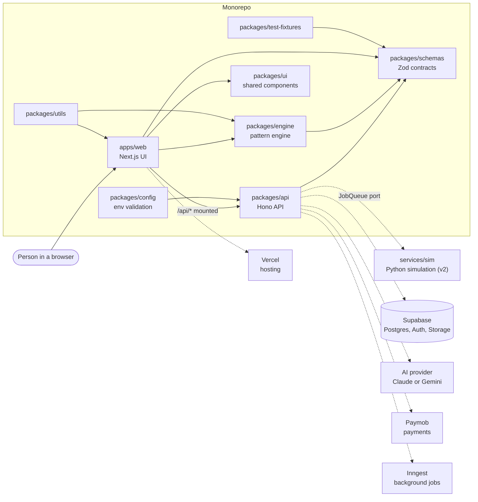

# The system on one page

Tafsila turns garment photos into accurate sewing patterns. The core idea ([ADR-002](../../DECISIONS.md)): **AI understands, the engine draws.** AI only fills in a small, validated description of the garment (the `DesignSpec`). A deterministic program (the engine) does all the drawing, so the same input always gives the same millimetre-accurate pattern.

Source of truth: [ARCHITECTURE.md](../../ARCHITECTURE.md) and [SRS section 3](../../SRS.md). This page is the picture.

## Parts and how they talk

Solid lines exist in the repo today. Dotted boxes are **planned** (see the SRS section or ADR named in the table below).

Arrows describe "uses". The engine runs in the browser (instant regeneration) and on the server (exports). Only the dotted `api -.-> ...` lines are not built yet.

## What each part is

| Part                     | One line                                                                              | Status today                                                            | Read more                                                         |
| ------------------------ | ------------------------------------------------------------------------------------- | ----------------------------------------------------------------------- | ----------------------------------------------------------------- |
| `apps/web`               | The website (Next.js). Pages are thin; it also hosts the API at `/api`.               | Skeleton page and `/api` mount                                          | [feature-sliced](../patterns/feature-sliced-frontend.md)          |
| `packages/api`           | The HTTP API (Hono) with routes, services, ports and adapters.                        | `/api/health`, error handling, clock port                               | [hexagonal](../patterns/hexagonal-ports-adapters.md)              |
| `packages/engine`        | Pure maths that drafts pattern pieces.                                                | Geometry helpers and sleeve-cap solver                                  | [functional core](../patterns/functional-core-plugin-pipeline.md) |
| `packages/schemas`       | Zod definitions of the data shapes shared by everyone (`DesignSpec`, `Measurements`). | `DesignSpec`, `Measurements`                                            | [schema-first](../patterns/schema-first-contracts.md)             |
| `packages/ui`            | Shared, RTL-first components.                                                         | `Button`                                                                | [frontend docs](../../frontend/README.md)                         |
| `packages/config`        | Reads and validates environment variables.                                            | `loadServerEnv`                                                         | [composition root](../patterns/composition-root.md)               |
| `packages/utils`         | Small helpers (units).                                                                | `cmToMm`, `mmToCm`, `roundTo`                                           | [repo-tour](repo-tour.md)                                         |
| `packages/test-fixtures` | Shared sizes, measurements and designs for tests.                                     | Exists                                                                  | [code-style](../code-style.md)                                    |
| `services/sim`           | Python cloth simulation for a later release.                                          | Dockerfile only (v2)                                                    | [ARCHITECTURE section 4](../../ARCHITECTURE.md)                   |
| Supabase                 | Postgres database, login (Auth) and file storage.                                     | Planned (`supabase/migrations` is empty), [SRS section 7](../../SRS.md) | [ADR-003](../../DECISIONS.md)                                     |
| Vercel                   | Hosts the web app; a Docker image is also built for portability.                      | Docker image built in CI                                                | [ADR-003, ADR-004](../../DECISIONS.md)                            |
| Inngest                  | Runs background jobs. A dev server is in `compose.yaml`.                              | Dev server only; jobs planned                                           | [SRS section 3.1](../../SRS.md)                                   |
| Paymob                   | Egyptian payment provider (cards, wallets, Fawry).                                    | Planned (milestone M7)                                                  | [SRS section 4.14](../../SRS.md)                                  |
| AI provider              | Reads garment photos and fills a `DesignSpec`; also proposes chat edits.              | Planned (milestone M6), env keys exist                                  | [SRS section 9](../../SRS.md)                                     |

## Rules that hold the picture together

1. The engine never talks to the network, a database or the clock. See [functional core](../patterns/functional-core-plugin-pipeline.md).
2. Services never import adapters, only ports. See [hexagonal](../patterns/hexagonal-ports-adapters.md).
3. Every data shape lives once, in `packages/schemas`.
4. These rules are checked by `pnpm depcruise` (see `.dependency-cruiser.cjs`), so a pull request that breaks them cannot merge.

Next: [request journey](request-journey.md) · [pattern journey](pattern-journey.md) · [repo tour](repo-tour.md).
