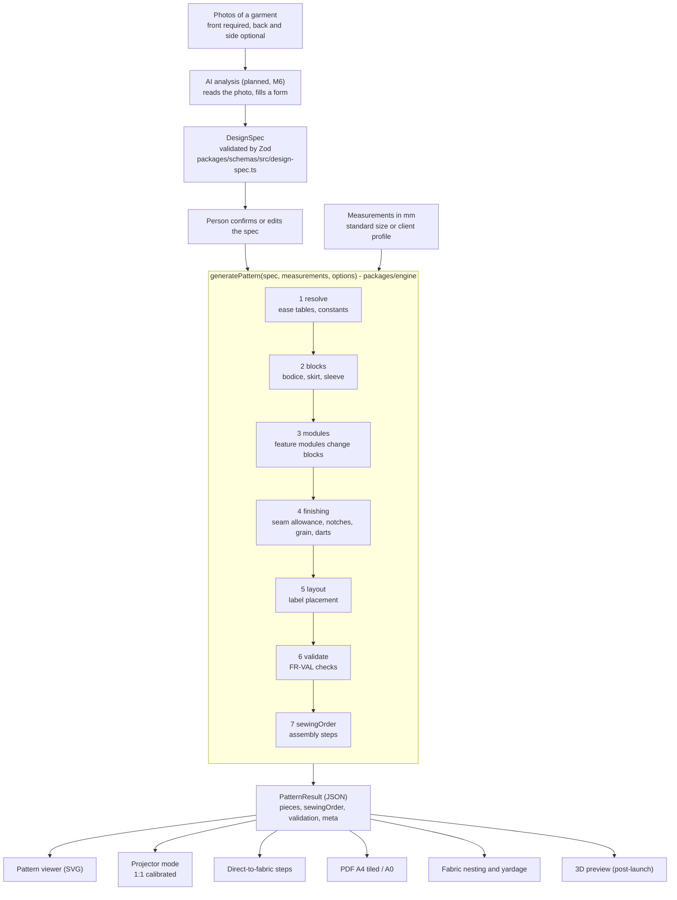

# From photo to pattern

How a garment photo becomes a ready-to-cut pattern. Source of truth: [ARCHITECTURE section 3](../../ARCHITECTURE.md), [engine docs](../../engine/README.md), [SRS sections 4.3-4.9, 6](../../SRS.md).

> **Status:** only the engine's geometry helpers and the sleeve-cap solver exist today. The photo analysis, the full pipeline and the outputs are planned (milestones M2, M3, M4 and M6 in [WORKFLOW section 8](../../WORKFLOW.md)). This page describes the design the code is being built to.

## The one rule

**AI never returns geometry.** Its output must pass `designSpecSchema`; invalid output is retried once, then the person edits by hand ([SRS section 3.3](../../SRS.md)). Everything with numbers in it comes from the deterministic engine, so results are reproducible and testable ([ADR-002](../../DECISIONS.md)).

## What the pieces are

| Piece              | What it is                                                                                                                                                                     | Where                                                           |
| ------------------ | ------------------------------------------------------------------------------------------------------------------------------------------------------------------------------ | --------------------------------------------------------------- |
| `DesignSpec`       | A JSON description of the garment: category (`dress`, `skirt`, `blouse`), neckline, sleeve, skirt type, closure, pockets, lining. Fabric is `woven` only in v1.                | `packages/schemas/src/design-spec.ts`, [SRS 6.1](../../SRS.md)  |
| `Measurements`     | Body measurements, always in millimetres.                                                                                                                                      | `packages/schemas/src/measurements.ts`, [SRS 6.2](../../SRS.md) |
| Blocks             | Basic parametric shapes drafted from measurements (see [block in the glossary](../glossary.md#block-sloper)).                                                                  | `packages/engine` (planned)                                     |
| Feature modules    | Plugins such as "V neckline" or "puff sleeve" that change blocks only when the spec asks for them. See [plugin pipeline](../patterns/functional-core-plugin-pipeline.md).      | `packages/engine` (planned), contract in ARCHITECTURE 3         |
| Geometry helpers   | Points, Bezier curves, polyline length.                                                                                                                                        | `packages/engine/src/geometry/`                                 |
| Sleeve-cap solver  | Finds the cap height that makes the sleeve cap longer than the armhole by the wanted ease, using bisection.                                                                    | `packages/engine/src/sleeve/sleeve-cap.ts`                      |
| `ValidationReport` | Pass, warn or fail for each FR-VAL rule (matching seam lengths, notch alignment, closed outlines...).                                                                          | [engine docs](../../engine/README.md), [SRS 4.5](../../SRS.md)  |
| `PatternResult`    | The JSON contract: pieces (stitch path, cut path with seam allowance, edges, notches, grain line, darts, labels), the sewing order, the validation report and `engineVersion`. | [SRS 6.3](../../SRS.md)                                         |
| `ENGINE_VERSION`   | Stamped on every result so a saved pattern re-renders identically later.                                                                                                       | `packages/engine/src/version.ts`                                |

## Why units are always millimetres

Sewing needs millimetre accuracy ([SRS NFR-01](../../SRS.md)). The engine only knows millimetres; the UI shows centimetres and converts with `cmToMm` and `mmToCm` from `packages/utils/src/units.ts`. Numeric names carry the unit: `armholeLengthMm`, `capEaseMm`.

## Outputs

| Output              | What it gives you                                             | Requirement              |
| ------------------- | ------------------------------------------------------------- | ------------------------ |
| Viewer              | The pieces on screen as SVG                                   | [SRS 4.6](../../SRS.md)  |
| Projector mode      | Pieces shown 1:1 on the fabric after a calibration step       | [SRS 4.7](../../SRS.md)  |
| Direct-to-fabric    | Numbered measured steps for cutting without a printed pattern | [SRS 4.8](../../SRS.md)  |
| PDF                 | A4 sheets to tape together, or A0 for a print shop            | [SRS 4.9](../../SRS.md)  |
| Nesting and yardage | How much fabric is needed at a chosen width                   | [SRS 4.10](../../SRS.md) |

Next: [repo tour](repo-tour.md).
