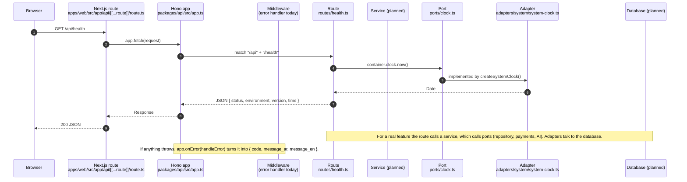

# One HTTP request, end to end

Follow `GET /api/health`, the only endpoint that exists today, from the browser to the answer. Every other endpoint will follow the same road, with a service, a port and an adapter added in the middle (marked **planned**).

Source of truth: [ARCHITECTURE section 2](../../ARCHITECTURE.md). Pattern: [hexagonal](../patterns/hexagonal-ports-adapters.md).



## Step by step

| #   | Where                                              | What happens                                                                                                                                                                                         |
| --- | -------------------------------------------------- | ---------------------------------------------------------------------------------------------------------------------------------------------------------------------------------------------------- |
| 1-2 | `apps/web/src/app/api/[[...route]]/route.ts`       | Next.js receives every `/api/*` call in one catch-all [route handler](https://nextjs.org/docs/app/getting-started/route-handlers) and forwards the standard `Request` to Hono. It contains no logic. |
| 3   | `packages/api/src/app.ts`                          | `createApp()` builds the Hono app with base path `/api`, mounts route groups, and registers `notFound` and `onError`.                                                                                |
| 4   | `packages/api/src/middleware/`                     | Today only the error handler exists. Planned: auth (Supabase JWT), request id and logging, rate limiting, error messages in two languages ([ARCHITECTURE section 2](../../ARCHITECTURE.md)).         |
| 5   | `packages/api/src/routes/health.ts`                | A route validates input (Zod, planned for real endpoints), calls one use case or reads the container, and shapes the HTTP answer. No business rules here.                                            |
| 6   | `packages/api/src/services/` (planned)             | A **use case** such as `CreatePatternVersion`: the business rules (credits, versions, permissions). Depends only on ports.                                                                           |
| 7   | `packages/api/src/ports/clock.ts`                  | A **port** is an interface describing what the service needs (`Clock.now()`), not how it is done.                                                                                                    |
| 8   | `packages/api/src/adapters/system/system-clock.ts` | An **adapter** implements the port (`new Date()`). Tests use a fake. Supabase, Paymob and AI adapters are planned.                                                                                   |
| 9   | `packages/api/src/container.ts`                    | The composition root decides which adapter fills each port. See [composition root](../patterns/composition-root.md).                                                                                 |
| 10  | back up the same road                              | The route returns JSON; Hono returns a `Response`; Next.js sends it to the browser.                                                                                                                  |

## When something fails

`packages/api/src/domain/errors.ts` defines `AppError` and `NotFoundError`. A service throws one; `packages/api/src/middleware/error-handler.ts` maps it to the one standard error body:

```json
{ "code": "NOT_FOUND", "message_ar": "العنصر المطلوب غير موجود", "message_en": "route not found" }
```

Unknown errors become a generic `500` without leaking details. The unknown-route case goes through the same handler (see `app.notFound` in `app.ts`).

## Try it

```bash
nvm use
pnpm dev
curl http://localhost:3000/api/health
```

The test `packages/api/src/app.test.ts` calls the same app with a fake clock, without starting a server.

Next: [pattern journey](pattern-journey.md).
