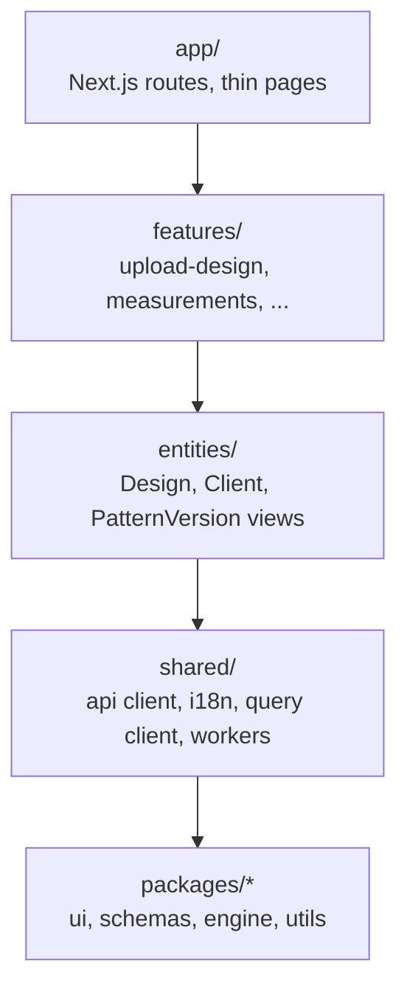

# Feature-sliced frontend

**One-line idea:** organise the web app by _what the user does_ (upload a design, measure a client), not by file type, with one folder per feature and strict import directions.

## Plain words

Instead of one giant `components/` and one giant `hooks/`, every feature owns its components, hooks and data shapes in one folder. Other code can only use a feature through its `index.ts` (its public door).

## Why Tafsila uses it

Each feature is self-contained, so agents and people can work on one without breaking others, and shared UI lives in one design system ([ARCHITECTURE section 1](../../ARCHITECTURE.md)).

## Layers and import direction



Rules ([docs/frontend/README.md](../../frontend/README.md)):

- Imports only go downward. A feature imports another feature only through its `index.ts` (rule `features-through-index` in `.dependency-cruiser.cjs`).
- Pages in `app/` compose features and hold no logic.
- Components show data from props; hooks fetch and mutate; no `fetch` inside components.
- Every string comes from `messages/{ar,en}.json`; CSS uses logical properties (`ms-*`, `me-*`) so right-to-left works.

Feature folder shape ([CODING_STANDARDS section 2](../../CODING_STANDARDS.md)):

```
apps/web/src/features/measurements/
├─ components/   hooks/   measurements.schema.ts   index.ts
```

## The four layers inside a feature (ADR-029)

| Layer       | Folder        | One-line rule                                         |
| ----------- | ------------- | ----------------------------------------------------- |
| UI          | `components/` | props in, JSX out; never fetches                      |
| Application | `hooks/`      | TanStack Query, forms, Zustand; calls `shared/api`    |
| Domain      | `model/`      | pure TypeScript, no React, no I/O                     |
| Data        | `shared/api/` | the only `fetch`; every failure becomes an `ApiError` |

dependency-cruiser fails the build when a component imports `shared/api`, TanStack Query or Supabase, or when `model/` imports React. ESLint rejects raw colours, `ml-*`/`left-*` classes, literal text in JSX and `fetch` outside `shared/api`. Examples: `.claude/rules/frontend/layering.md`. Errors: [docs/errors.md](../../errors.md).

## Where in our code

`shared/api` (the API client and `ApiError`) exists since #66. Of the feature layers only the first exists so far: `apps/web/src/app/[locale]/page.tsx` (a placeholder home page) and `apps/web/src/app/[locale]/layout.tsx`. The `features/`, `entities/` and `shared/` folders are **planned** from milestone M1; the first feature will be added with the `add-page` skill (`.claude/skills/add-page/SKILL.md`). Shared UI that already exists: `packages/ui/src/button.tsx`.

## Learn more

- [Feature-Sliced Design](https://feature-sliced.design/docs/get-started/overview)
- [Next.js: project organization](https://nextjs.org/docs/app/getting-started/project-structure)
- [next-intl](https://next-intl.dev/docs/getting-started) (planned translation library, [SRS section 3.1](../../SRS.md))
- Related: [modular monolith](modular-monolith.md)
