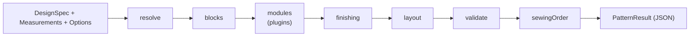

# Functional core and plugin pipeline

**One-line idea:** the pattern engine is made of pure functions that never touch the outside world, arranged as a fixed pipeline where garment features are plugins.

## Plain words

- **Pure function:** same input, same output, no side effects (no network, no database, no random numbers, no `Date`). Easy to test and to run anywhere.
- **Functional core:** the part of the program made only of pure functions. Impure things (HTTP, database) stay outside, in the API and UI.
- **Plugin pipeline:** the engine runs seven fixed steps; a _feature module_ (for example "V neckline") is a plugin that changes the drawing at step 3 only when the design asks for it. Adding a feature means adding a module, not editing existing ones (open/closed principle).



## Why Tafsila uses it

- Sewing needs millimetre accuracy and **reproducibility**: a stored pattern must redraw identically, so each result carries `ENGINE_VERSION` ([SRS NFR-08](../../SRS.md)).
- The same code runs in the browser (instant redraw) and on the server (exports) ([ADR-002](../../DECISIONS.md), [ARCHITECTURE section 3](../../ARCHITECTURE.md)).
- Property-based tests can check every validation rule across a whole size matrix.

## The module contract (from ARCHITECTURE section 3)

```ts
export interface FeatureModule {
  id: string; // "neckline/v", "sleeve/ruched"
  appliesTo(spec: DesignSpec): boolean;
  draft(ctx: DraftContext): DraftContext; // pure: returns a new context
  validations?: ValidationRule[];
}
```

This interface is the **design**; `FeatureModule` is not in code yet (the module catalogue in [engine docs](../../engine/README.md) says "none yet").

## Rules enforced by tooling

- `engine-is-pure` in `.dependency-cruiser.cjs`: `packages/engine` may not import apps, `packages/api|ui|config`, Next.js, React, Hono, Supabase or AI SDKs.
- Millimetres only, units in names (`capEaseMm`), no magic numbers ([CODING_STANDARDS sections 3 and 6](../../CODING_STANDARDS.md)).

## Where in our code

| What                                           | File                                           |
| ---------------------------------------------- | ---------------------------------------------- |
| Points and distances                           | `packages/engine/src/geometry/point.ts`        |
| Bezier curves                                  | `packages/engine/src/geometry/bezier.ts`       |
| A pure solver (bisection) with named constants | `packages/engine/src/sleeve/sleeve-cap.ts`     |
| A domain error with a stable code              | `packages/engine/src/errors/drafting-error.ts` |
| Version stamp                                  | `packages/engine/src/version.ts`               |
| Public entry (nothing else is importable)      | `packages/engine/src/index.ts`                 |

Pipeline steps `resolve` through `sewingOrder` and the module registry are **planned** for milestone M2.

## Learn more

- [Gary Bernhardt: Functional Core, Imperative Shell](https://www.destroyallsoftware.com/screencasts/catalog/functional-core-imperative-shell)
- [Open-closed principle (Wikipedia)](https://en.wikipedia.org/wiki/Open%E2%80%93closed_principle)
- [fast-check (property-based testing)](https://fast-check.dev/docs/introduction/)
- Related: [pattern journey](../map/pattern-journey.md), [schema-first contracts](schema-first-contracts.md)
