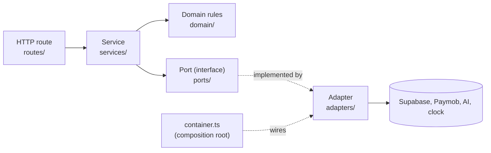

# Hexagonal architecture (ports and adapters)

**One-line idea:** business rules sit in the middle and talk to the outside world only through small interfaces, so databases, payment and AI vendors can be swapped without touching the rules.

## Plain words

- **Port:** an interface that says what the business logic needs ("give me the current time", later "save this design").
- **Adapter:** the code that fulfils a port with a real tool (the system clock, Supabase, Paymob, an AI provider) or a fake for tests.
- **Service (use case):** one business action, such as "create a pattern version". It depends on ports, never on adapters.
- **Domain:** rules and errors with no input or output.



## Why Tafsila uses it

Business rules (credits, versions, plan limits) must not depend on Supabase, Paymob or one AI vendor ([ADR-006](../../DECISIONS.md)). Services are tested fast and offline with in-memory fakes; swapping a vendor means a new adapter plus one line in `container.ts` ([ARCHITECTURE section 2](../../ARCHITECTURE.md)).

## The rules and who checks them

| Rule                                          | Checked by                                                     |
| --------------------------------------------- | -------------------------------------------------------------- |
| Services never import adapters or vendor SDKs | `services-use-ports-not-adapters` in `.dependency-cruiser.cjs` |
| The UI never imports services or adapters     | `ui-not-backend`                                               |
| One use case per file, named as an action     | Review ([ARCHITECTURE section 2](../../ARCHITECTURE.md))       |

## Where in our code

The only complete example today is the clock:

| Piece                | File                                                                  |
| -------------------- | --------------------------------------------------------------------- |
| Port                 | `packages/api/src/ports/clock.ts` (`interface Clock { now(): Date }`) |
| Real adapter         | `packages/api/src/adapters/system/system-clock.ts`                    |
| Fake in tests        | `fixedClock` in `packages/api/src/app.test.ts`                        |
| Route using the port | `packages/api/src/routes/health.ts` (`container.clock.now()`)         |
| Wiring               | `packages/api/src/container.ts`                                       |
| Domain errors        | `packages/api/src/domain/errors.ts`                                   |

Everything else in `ports/` (`DesignRepository`, `FileStorage`, `PaymentGateway`, `AIProvider`, `JobQueue`...) is **planned** and listed in [ARCHITECTURE section 2](../../ARCHITECTURE.md).

Excerpt from `packages/api/src/ports/clock.ts`:

```ts
/** Source of the current time. */
export interface Clock {
  /** Returns the current instant. */
  now(): Date;
}
```

## Learn more

- [Alistair Cockburn: Hexagonal architecture](https://alistair.cockburn.us/hexagonal-architecture/)
- [Robert C. Martin: The Clean Architecture](https://blog.cleancoder.com/uncle-bob/2012/08/13/the-clean-architecture.html)
- [Hono documentation](https://hono.dev/docs/)
- Related: [composition root](composition-root.md), [request journey](../map/request-journey.md)
